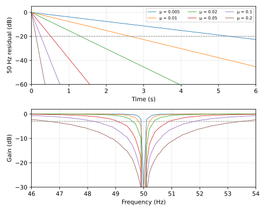

# Lab Book: ECG FIR Filtering

## 1. Spectrum Analysis

**Recording**
- ECG is in column 8 of the `.tsv`.
- fs = 250 Hz, so the Nyquist frequency is 125 Hz.

**Signal**
- The ECG itself sits roughly between 0.5 and 40 Hz.

**Noise identified**
- **Baseline wander:** below about 0.5 Hz.
- **50 Hz mains:** very strong, about 200× the median spectral level.
- **100 Hz harmonic:** weak, about 3× the median, but still worth mentioning.
- **Aliasing:** the 150 Hz harmonic aliases to 100 Hz, and 200 Hz aliases to 50 Hz.

**Bands to remove**
- 0 – 0.5 Hz => baseline wander, below the ECG range
- 45 – 55 Hz => 50 Hz mains (plus the 200 Hz alias)
- 95 – 105 Hz => 100 Hz harmonic (plus the 150 Hz alias)

## 2. Coefficient Design Function
Number of co-efficients (taps) is based on the smallest band to remove.

Smallest band is 0.5Hz, therefore if M is the no. of co-efficients

M = Fs / 0.5Hz = 250Hz / 0.5Hz = 500

The filter will delay the sample by (M-1) / 2, so let **M = 501**

We can add a hamming window too to smooth the edges from the filtering.

## 3. Realtime FIR Class

## 4. Adaptive LMS

### Learning rate sweep (`code/lms_sweep.py`)

**Setup**
- ECG high-passed at 0.5 Hz first (`design(FS, [(0, 0.5)])`), to remove the DC offset (~22 mV) that otherwise leaks into the LMS error and adds 100 Hz noise.
- LMS: 2 taps, reference `sin(2π·50/FS·n)`, update `w += μ·e·x`.

**Method**
- **Convergence time:** cancel a known 50 Hz tone (phase-shifted 60° from the reference) and record when the residual stays below −20 dB.
- **50 Hz attenuation:** the 50 Hz FFT peak of the LMS output vs the high-pass-only signal, skipping the first 5 s.
- **Notch width:** feed pure tones at 46–54 Hz (0.1 Hz steps) and measure the output/input gain. The width is the band below −3 dB, i.e. how much ECG near 50 Hz is lost.

**Results**

| Learning rate (μ) | Convergence time (s) | 50 Hz attenuation (dB) | Notch −3 dB width (Hz) |
|---|---|---|---|
| 0.005 | 5.32 | −10.2 | 0.1* |
| 0.01 | 2.66 | −15.8 | 0.4 |
| 0.02 | 1.32 | −21.8 | 0.8 |
| 0.05 | 0.52 | −29.7 | 1.8 |
| 0.1 | 0.26 | −35.6 | 3.6 |
| 0.2 | 0.12 | −41.5 | 6.9 |

\*Limited by the 0.1 Hz test-tone step.

**Observations**
- Convergence time halves each time μ doubles (∝ 1/μ), and notch width doubles (∝ μ). This is the speed vs selectivity trade-off of LMS.
- Attenuation improves by about 6 dB per doubling of μ.
- The real mains is at 49.96 Hz, not exactly 50 Hz. A very narrow notch (μ = 0.005) only partly covers it, hence the weak −10 dB.
- μ ≥ 0.1 gives a 3.6–6.9 Hz notch, which starts removing ECG content around 50 Hz.

**Chosen: μ = 0.05.** It gives ~30 dB attenuation, settles in ~0.5 s, and the notch is ~1.8 Hz wide, much narrower than the 45–55 Hz (10 Hz) stop band of the fixed FIR.

## 5. Matched Filter and Heart Rate
